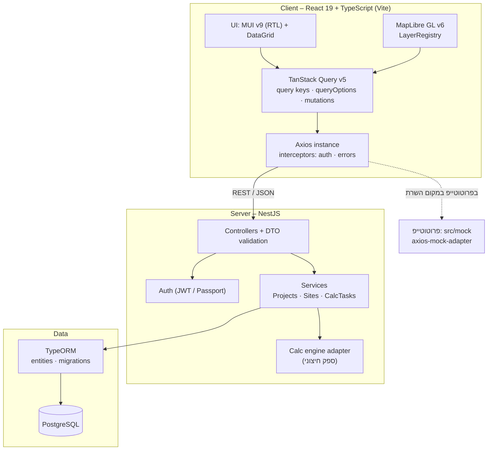

<div dir="rtl">

# Site Planner – מתכנן אתרי תקשורת


**תוכנית חפיפה - צוות גלי ישראל** · פרוטוטייפ (Frontend בלבד)

> 📋 **התוכנית המלאה, 45 המשימות והמעקב:** [docs/ONBOARDING-PLAN.md](docs/ONBOARDING-PLAN.md) · מעקב שוטף ב-Issues וב-Milestones של הריפו.

---

## מה זה?

זהו **פרוטוטייפ לחיץ** של מוצר החפיפה. הוא מראה **את היעד** – מה המפתח החדש בונה בעצמו מאפס במהלך שבעת שבועות החפיפה.

- כל המסכים עובדים מול **Mock API בזיכרון** (`src/mock`) שמדמה השהיה (300–600ms) ושגיאות.
- הארכיטקטורה בצד הלקוח היא **ארכיטקטורת היעד**: גישה לנתונים רק דרך hooks של React Query, axios instance יחיד, query key factory, mutations עם invalidation, מחיקה אופטימית עם rollback, polling עם `refetchInterval`, ו-LayerRegistry לשכבות המפה.
- בגרסה שהמפתח בונה, ה-mock מוחלף ב-**NestJS + TypeORM + PostgreSQL** אמיתיים. ה-UI לא אמור להשתנות – רק `VITE_USE_MOCK=false` ו-`VITE_API_URL`.

> ⚠️ זה פרוטוטייפ, לא קוד להעתקה. המטרה היא להבין *מה* בונים ו*איך זה אמור להרגיש*. את הקוד כותבים מחדש, שבוע אחרי שבוע, עם PR-ים, טסטים ו-ADR-ים.

## הרצה

```bash
npm i
npm run dev        # http://localhost:5173
```

פקודות נוספות:

| פקודה | מה עושה |
|---|---|
| `npm run build` | `tsc -b` (strict) + build ל-`dist/` |
| `npm run typecheck` | בדיקת טיפוסים בלבד |
| `npm run lint` | ESLint (כולל `no-explicit-any`) |
| `npm run format` | Prettier |
| `npm run preview` | הגשת ה-build המקומי |

- ה-build משתמש ב-`base: './'` וב-`HashRouter`, כך שאפשר להגיש את `dist/` מכל נתיב (גם כתיקייה סטטית).
- מפת הבסיס: `https://tiles.openfreemap.org/styles/liberty` (ללא מפתח API) – דורש אינטרנט. בלי אינטרנט ה-UI עובד, אבל רקע המפה יהיה ריק.
- התחברות: **כל שם משתמש** מתקבל (session ב-`sessionStorage`). הנתונים מתאפסים ברענון הדף.
- בכותרת יש **🐞 כלי פיתוח** – מתג "הדמיית שגיאות" שגורם ל-~25% מהבקשות להיכשל ב-500, כדי לראות מצבי שגיאה, retry ו-rollback.

## מסכים

| # | מסך | מה יש בו |
|---|---|---|
| 1 | **התחברות** | התחברות מדומה, שמירת session, route guard (`RequireAuth`) שמחזיר לדף המקורי אחרי התחברות |
| 2 | **רשימת פרויקטים** | כרטיסים / טבלה, חיפוש בצד "שרת" (עם `useDeferredValue`), דיאלוג יצירת פרויקט עם ולידציה |
| 3 | **מסך פרויקט** | Split view: DataGrid של אתרים (מיון, סינון, עמודים, חיפוש מהיר) + מפת MapLibre. עיגולים בצבע לפי סוג (data-driven `match`), הדגשה ב-hover/בחירה עם `feature-state`, לחיצה על אתר ← popup + בחירת השורה (כולל מעבר לעמוד הנכון), בחירת שורה ← הדגשה + `flyTo`. יצירת אתר מכפתור או **בלחיצה על המפה** (קואורדינטות ממולאות), עריכה, מחיקה אופטימית. פאנל שכבות. `fitBounds` לפרויקט |
| 4 | **משימות חישוב** | "הרץ חישוב כיסוי" (בחירת מודל התפשטות) ← משימה `queued → running (%) → done/failed`, polling שנעצר כשאין משימות פעילות. תוצאה = פוליגון כיסוי (64 נקודות) לכל אתר, רדיוס לפי `powerW`/`heightM`, מוצג כשכבת fill+outline דרך ה-LayerRegistry. **השוואת ריצות**: שתי ריצות בצבעים שונים + טבלת הפרשים (מספר אתרים, שטח מכוסה בקמ״ר, רדיוס ממוצע, אתרים שנוספו/הוסרו) |
| 5 | **מצבים** | Loading / Skeleton / Empty / Error (עם "נסה שוב") בכל מסך, Snackbar להודעות הצלחה/שגיאה |

## ארכיטקטורת המערכת האמיתית (היעד)



### REST API (כפי שה-mock מממש – החוזה לשרת האמיתי)

| Method | Path | תיאור |
|---|---|---|
| POST | `/auth/login` | התחברות ← `{ token, user }` |
| GET | `/projects?search=` | רשימת פרויקטים |
| POST | `/projects` | יצירת פרויקט |
| GET | `/projects/:id` | פרויקט |
| GET | `/projects/:id/sites` | אתרי הפרויקט |
| POST | `/projects/:id/sites` | יצירת אתר |
| PUT | `/sites/:id` | עדכון אתר |
| DELETE | `/sites/:id` | מחיקת אתר |
| GET | `/projects/:id/tasks` | משימות חישוב |
| POST | `/projects/:id/tasks` | הרצת חישוב `{ model }` |
| GET | `/tasks/:id` | סטטוס משימה |
| GET | `/tasks/:id/result` | תוצאה: `{ summary, coverage: FeatureCollection }` |

### מבנה הקוד

```
src/
  types/domain.ts        מודל הדומיין (יעבור לחבילת types משותפת client/server)
  api/http.ts            axios instance + interceptors + ApiError
  api/endpoints.ts       פונקציות API טיפוסיות
  queries/               keys.ts (factory) · projects/sites/tasks (queryOptions, hooks, mutations)
  mock/                  seed · db בזיכרון · router (ה"שרת") · calcEngine · installMockApi
  auth/                  session · AuthProvider · RequireAuth
  features/map/          maplibreSetup (worker v6) · MapView · layerRegistry · layers · LayersPanel
  features/sites/        SitesGrid · SiteFormDialog
  features/tasks/        TasksPanel · CompareRuns · CoverageLayers
  pages/                 Login · Projects · Project
  lib/                   geo (מעגל→פוליגון, שטח) · validation · labels · notify
  theme/                 theme (RTL + heIL) · RtlProvider (emotion + stylis-plugin-rtl)
```

## מיפוי לשבועות החפיפה

| שבוע | נושא | מה בונים (ומה רואים בפרוטוטייפ) |
|---|---|---|
| **W1** | שלד + רשימת פרויקטים על mock | Vite + React 19 + TS strict, ESLint/Prettier, מודל דומיין, React Router, מסך רשימת פרויקטים עם חיפוש על נתוני mock |
| **W2** | UI מלא ב-MUI על mock | MUI + RTL, Theme, התחברות מדומה + guard, DataGrid אתרים, טפסים עם ולידציה, דיאלוגים, מצבי loading/empty/error, Snackbar |
| **W3** | שרת NestJS + PostgreSQL + auth | Modules/Controllers/Services, DTO + class-validator, TypeORM entities + migrations, JWT, REST API לפי החוזה שלמעלה, Docker Compose |
| **W4** | חיבור Axios + React Query | axios instance + interceptors, query key factory, `queryOptions`, mutations + invalidation, מחיקה אופטימית עם rollback, devtools |
| **W5** | המפה | MapLibre v6 (worker), שכבת אתרים data-driven, hover/selection עם feature-state, popup, סנכרון טבלה↔מפה, יצירה בלחיצה, `fitBounds`, פאנל שכבות |
| **W6** | משימות חישוב + תוצאות + השוואה | ישות CalcTask בשרת, תור/סטטוסים, polling עם `refetchInterval`, פוליגוני כיסוי, LayerRegistry, השוואת שתי ריצות + טבלת הפרשים |
| **W7** | טסטים, ליטוש, שחרור v1.0 | Vitest + RTL + טסטי e2e, ביצועים, נגישות, CHANGELOG, דמו סופי, תג `v1.0.0` |

## תיק החפיפה

בתיקייה [`docs/`](docs/) נמצאות התבניות שהמפתח ממלא לאורך החפיפה:

- [`docs/PRD.md`](docs/PRD.md) – מסמך דרישות המוצר
- [`docs/adr/0000-template.md`](docs/adr/0000-template.md) – תבנית Architecture Decision Record
- [`docs/CHANGELOG.md`](docs/CHANGELOG.md) – לפי Keep a Changelog
- [`docs/weekly-demo.md`](docs/weekly-demo.md) – תבנית לדמו השבועי
- [`docs/retro.md`](docs/retro.md) – תבנית רטרו

## גרסאות (נכון לבניית הפרוטוטייפ)

| חבילה | גרסה |
|---|---|
| React / React DOM | 19.3.1 |
| TypeScript | 6.0.3 (ראו הערה) |
| Vite / @vitejs/plugin-react | 8.3.8 / 6.3.0 |
| MUI (material, icons) / X Data Grid | 9.5.0 / 9.17.0 |
| React Router | 8.5.1 (`HashRouter`) |
| TanStack Query (+ devtools) | 5.107.1 |
| axios / axios-mock-adapter | 1.21.1 / 2.1.0 |
| maplibre-gl | **6.18.0** (ESM, worker דרך `setWorkerUrl`) |
| ESLint / typescript-eslint | 10.14.0 / 8.72.2 |

### הערות וסטיות

- **TypeScript 6.0.3 ולא 7.x**: ‏TS 7.0.2 הוא ה-latest ב-npm, אבל `typescript-eslint` 8.72 עדיין לא תומך בו כ-peer, ולכן npm בחר את 6.0.3. מעבר ל-7 כשה-lint יתמוך.
- **MapLibre v6** עובד ב-dev וב-build. ב-v6 ה-worker הוא קובץ ESM נפרד שנטען יחסית לספרייה; אחרי bundling מייבאים אותו כ-asset (`maplibre-gl/dist/maplibre-gl-worker.mjs?url`) ומגדירים `setWorkerUrl` (ראו `src/features/map/maplibreSetup.ts`). שימוש בעטיפה נקייה (`useRef`/`useEffect`) ולא ב-react-map-gl.
- `maplibre-gl.css` מגדיר `position: relative` ל-container של המפה, לכן ה-container הוא div פנימי בגודל 100% בתוך wrapper ממוקם.
- **MUI v9** הסיר את ה-system props (כמו `alignItems` על `Stack`, `fontWeight` על `Typography`) – הכל עובר ב-`sx`.
- ב-RTL, ‏`stylis-plugin-rtl` הופך `left`↔`right` בכל סגנונות ה-emotion. לכן `left: 12` ב-`sx` מופיע בצד ימין במסך. ה-controls של MapLibre לא עוברים דרך emotion ולכן לא מתהפכים.
- תוויות בעברית על המפה מעוצבות דרך `setRTLTextPlugin` (נטען מ-unpkg, לא חוסם).
- רדיוס הכיסוי הוא נוסחת "צעצוע" לפרוטוטייפ (`lib/geo.ts`), והשטח הכולל הוא סכום שטחי המעגלים (חפיפות נספרות פעמיים) – לא חישוב התפשטות אמיתי.
- ~10% מהמשימות נכשלות בכוונה (סימולציה) כדי להראות את מצב `failed`.

</div>
